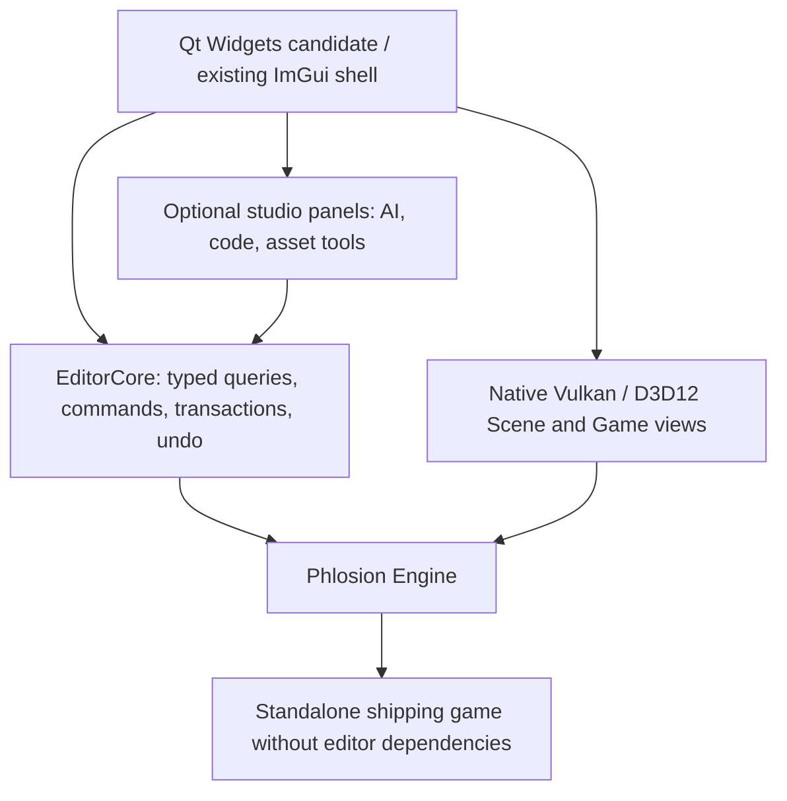
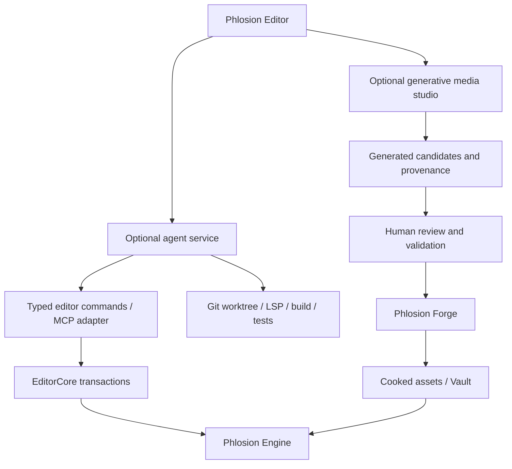
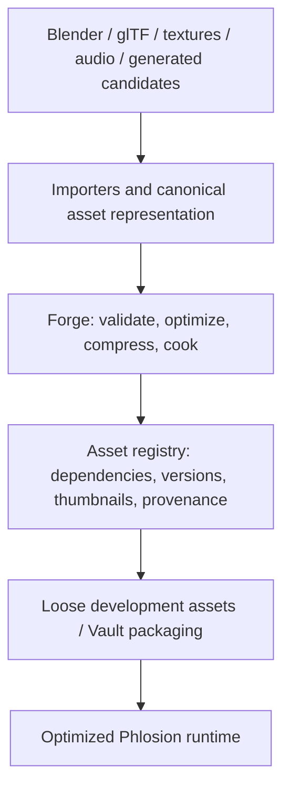

# Phlosion Engine: Product Direction and Technology Evaluation Roadmap

**Status:** Exploratory / proposed  
**Discussion date:** 2026-11-23  
**Intended repository path:** `docs/PRODUCT_DIRECTION.md`

This document captures the long-term product vision, technology candidates and sequencing discussed for Phlosion Engine. It is not a committed implementation plan. Existing contracts, repository ownership boundaries and dated qualification evidence remain authoritative. Revalidate repository state and dependency versions before acting. Do not start speculative work simply because a technology is listed here.

## 1. Product vision

Build a lightweight, high-performance, cross-platform C++ game engine paired with a professional, local-first, AI-native development studio. The intended audience includes independent developers and small teams with local AI-capable machines. The long-term goal spans indie games through selected AAA-scale requirements, without copying every feature of Unreal Engine or Unity.

**AI handles repetitive implementation, testing and content generation; humans retain artistic direction, gameplay design, spatial composition, precise authoring and final quality.** The editor should prioritize visual tools for inspecting, correcting and refining outputs that current AI systems cannot reliably finish.

The engine should consist of modular runtime services and optional authoring tools, not a monolithic mandatory installation. Shipping games must not depend on the editor, local language models, generative-media runtimes, model weights or development infrastructure.

Avoid rebuilding mature GUI frameworks, physics libraries, compression algorithms, DCC tools and AI models. Phlosion's value lies in the integration, performance, usability, reliable ownership contracts and workflows it provides.

## 2. Repository baseline and illustrative maturity assessment

The public repository was reviewed at the discussion date; it was not independently compiled or benchmarked during this review. Source presence and existing tests establish specific capabilities, not universal production readiness.

Documented foundations include:

- Independently buildable C++20 engine with game-owned rules/content, CMake/vcpkg, explicit plugin contracts and optional packages.
- ECS, events, runtime lifecycle, Lua, SDL2 input/windowing and Jolt-backed collision/character primitives.
- Active Vulkan and Direct3D 12 rendering; legacy OpenGL opt-in, not a routine feature-parity requirement.
- PBR, clustered lighting, directional/local shadows, diffuse and reflection probes, screen-space/planar reflections, HDR, bloom, sky, clouds, fog, foliage, wind, rain and wet surfaces.
- Model/glTF import, skeletal animation, materials, attachments, audio, input, text/focus and VFX foundations.
- Native Dear ImGui editor with project selection, hierarchy/inspector, Scene/Game surfaces, transform tools, asset previews, gameplay reload and versioned game/editor extensions.
- PHRC and typed resources, asynchronous asset loading, dependency graphs, staged activation, and planned Forge/Vault pipeline.
- Strong automated CPU contracts, public fixtures and native visual/performance evidence. Windows is the main documented CI target; Linux has limited runtime evidence, not general platform qualification.

### Indicative maturity (subjective, not a schedule)

The discussion-level overall estimate was **32/100** (rough range 25–40), weighted toward the full AI-native and AAA-scale ambition. It is not an arithmetic mean of the rows below, a count of completed tasks, or an estimate of time remaining. It must not be presented as measured Unreal parity.

| Area | Estimated maturity /100 |
| --- | ---: |
| Core architecture | 78 |
| Modularity and separation of concerns | 75 |
| ECS and runtime systems | 65 |
| Physics and collision | 50 |
| Gameplay scripting | 45 |
| Rendering capabilities | 60 |
| Lighting and materials | 65 |
| Rendering performance and scalability | 40 |
| Animation and character systems | 50 |
| VFX | 45 |
| Audio | 30 |
| Game UI systems | 30 |
| Native editor | 40 |
| Asset pipeline | 40 |
| World building and streaming | 20 |
| Build and distribution tooling | 25 |
| Cross-platform qualification | 30 |
| Automated testing and verification | 75 |
| Multiplayer/networking | 5 |
| Integrated agentic coding | 10 |
| Agent-controlled editor operations | 10 |
| Generative asset production | 5 |
| Integrated AI orchestration | 5 |

Additional discussion estimates: core foundations 73/100, independent game prototype readiness 65/100, general-purpose AAA production readiness 18/100 and integrated AI development environment 8/100. Replace subjective estimates over time with validated milestones, measured budgets and complete game workflows. See [Verification](VERIFICATION.md), [Engine boundaries](ENGINE_BOUNDARIES.md), [Renderer policy](RENDERER_POLICY.md), [Editor architecture](EDITOR_ARCHITECTURE.md) and [Asset architecture](PHLOSION_ASSET_ARCHITECTURE.md).

## 3. Professional editor frontend

The current ImGui editor is a functional foundation, but the desired appearance is a stylized, polished professional creative application comparable in usability and presentation to Unreal or Unity. Create a distinct Phlosion design system: typography, spacing, color, icons, responsive docking, contextual inspectors, hierarchy and asset browser, project navigation and prominent native scene/game viewports.

### Framework research

Unreal Engine uses its own Slate UI framework; Unity uses UI Toolkit and its own IMGUI (not Dear ImGui). CryEngine Sandbox is a relevant example of a professional C++ engine editor built with Qt. Maya, Houdini and Nuke also offer useful references for creative-tool workflows; their existence does not by itself establish a particular Phlosion integration path.

| Candidate | Assessment |
| --- | --- |
| Customized Dear ImGui | Lowest disruption and dependency cost; can be polished substantially, but rich desktop tooling, accessibility and styling need more custom effort |
| Qt 6 Widgets | Preferred prototype: mature docking, menus, trees/tables, inspectors, model/view widgets and desktop application behavior |
| Qt Widgets + selective QML | Optional rich AI/chat and generation panels; more integration and maintenance complexity |
| Qt Quick exclusively | Highly stylable retained-mode UI; docking and native viewport integration require investigation |
| React + Tauri | Rich web tooling and styling; native renderer/window/input integration is a significant risk |
| React + Electron | Rich web tooling but less aligned with a lightweight editor; native renderer integration still required |
| RmlUi | Potential lightweight in-game UI; a full desktop editor framework would require considerable additional tooling |
| Custom Slate-like framework | Maximum control, but disproportionate work for a solo engine project |

**Preferred long-term candidate: Qt 6 Widgets, subject to a successful prototype.** Keep Dear ImGui functional until a replacement proves itself; retain it as an optional runtime diagnostics layer. A carefully styled ImGui version is the control against a full migration. Prefer one primary UI technology and add QML only if concrete panels warrant it.

| Technology | Potential role |
| --- | --- |
| [Qt Widgets](https://doc.qt.io/qt-6/qtwidgets-index.html) | Native main window, docks, menus, hierarchy, inspector and model/view asset browser |
| [Qt Quick](https://doc.qt.io/qt-6/qtquick-index.html) | Optional fluid, rich AI/chat and media panels |
| [Qt Advanced Docking System](https://github.com/githubuser0xFFFF/Qt-Advanced-Docking-System) | Evaluate advanced Unreal-style docking and layout persistence |
| [QtNodes](https://github.com/paceholder/nodeeditor) | Optional node editor for materials or generative workflows |
| [QScintilla](https://www.riverbankcomputing.com/software/qscintilla/intro) or another code editor widget | Syntax highlighting and editing; integrate clangd and review license carefully |
| [QDarkStyleSheet](https://github.com/ColinDuquesnoy/QDarkStyleSheet) | Optional dark theme starting point; build Phlosion's own design identity |

Review Qt module-specific LGPL/GPL/commercial terms, redistribution obligations, linking choices and all third-party licenses for compatibility with the Apache-2.0 project. Avoid a mandatory proprietary or GPL-only dependency unless a deliberate distribution decision permits it.

### UI architecture and migration gate

The editor's document model, commands, stable object IDs, transactions and game/plugin contracts should remain toolkit-independent. The existing [editor architecture](EDITOR_ARCHITECTURE.md) treats ImGui as a replaceable presentation dependency; verify actual implementation boundaries rather than assuming every planned contract exists.

Prototype one representative workspace in Qt and styled ImGui: hierarchy, inspector, asset library, Scene/Game surfaces, play/pause and a placeholder agent panel. Evaluate:

- Native Vulkan and D3D12 rendering, correct surface ownership, resize, DPI, multiple windows, focus, mouse capture and keyboard/controller input.
- Device/queue/fence synchronization, swapchain lifecycle, graphics correctness and avoidance of unnecessary texture copies or competing devices.
- Existing project plugins, command routing, selection, transaction/undo behavior and saved layouts. No Qt types in engine/game ABI.
- Windows and Linux buildability, startup time, idle memory, viewport frame latency, editor responsiveness, keyboard navigation and accessibility.
- Deployment/package size, runtime dependency footprint and license compliance.

Only select a migration after the viewport and behavioral acceptance gates pass. Do not rewrite a working editor simply to change its appearance.

## 4. Human authoring workspaces

The editor should provide configurable workspaces within a unified shell, not unrelated applications. Use manual tools for activities requiring visual judgment or precise correction, while agents handle routine implementation and repetitive content generation.

| Workspace | Human tools | Agent-assisted work |
| --- | --- | --- |
| Scene and World | Placement/gizmos, terrain/foliage painting, collision, lighting, weather, spatial composition | Layout proposals, environment population, repetitive scene setup |
| Character | Mesh/skeleton inspection, attachment fitting, skin weight and deformation correction, clipping and LOD previews | Generate meshes/textures, propose rigging or attachments, detect issues |
| Animation and Cinematics | Timelines, curves, poses, retargeting, blends, cameras, events | Generate/retarget motions, build sequence candidates |
| Materials and VFX | Parameter controls, previews, particle/effect inspection | Generate textures, implement shaders, propose effects |
| Code and Agents | Code/diff review, diagnostics, builds, debugging, tests, task history | Implement/refactor gameplay, run tests, explain changes |
| AI Studio | Model/workflow selection, generation inputs, candidate comparison, acceptance | Image, texture, 3D, animation and audio generation |
| Performance | Frame times, memory, GPU/CPU scopes, regressions | Investigate bottlenecks and propose verified optimizations |

Character correction is particularly important: a generated cybernetic shoulder attachment is not usable until fit, skinning, deformation, clipping and animation compatibility are validated. Integrate Blender rather than recreating a full DCC. Do not build a comprehensive Blueprint-like visual programming language unless a real user workflow justifies it; agentic C++/Lua coding is the intended primary implementation path.

## 5. Local-first AI development architecture

Treat agentic coding and generative media as optional development services. Phlosion can share infrastructure with Jarvin/GroundControl-style tools rather than implement another independent model manager and scheduler. The current editor roadmap already describes an out-of-process AI boundary; extend that design.

### Agentic coding and editor interaction

- EditorCore owns stable IDs, typed queries, commands, transactions, previews, validation, undo/redo and error reporting. Humans and agents use the same operation contracts.
- Expose a narrowly scoped [MCP](https://modelcontextprotocol.io/) adapter for scene inspection, object manipulation, asset search, play controls and build/test/capture operations. MCP is a tool interface, not a complete agent runtime or a security boundary.
- Integrate [clangd](https://clangd.llvm.org/)/LSP for C++ code intelligence, optionally [Tree-sitter](https://tree-sitter.github.io/tree-sitter/) for parsing, and Git for inspectable change history. Use explicitly scoped worktrees for code edits and show diffs before acceptance.
- Build a vertical slice: agent reads the project, proposes one scene or code change, validates it, runs a build/test or visual capture, and presents an inspectable result that can be rejected or undone.
- Use provider-neutral local inference through [llama.cpp](https://github.com/ggml-org/llama.cpp), Ollama or compatible endpoints. Optional external providers may be useful, but no mandatory cloud dependency.
- Require least-privilege access, explicit approval for destructive or privileged actions, audit logs, cancellation, recoverable edits and no silent overwriting of source or assets.

### Generative media studio

Integrate model and workflow providers rather than develop foundational generative models.

| Technology / provider | Role |
| --- | --- |
| [ComfyUI](https://docs.comfy.org/) | Local image/texture and compatible media workflows |
| Blender Python | Mesh processing, rigging, asset correction and export |
| TRELLIS / Hunyuan3D or other suitable providers | Optional 3D generation; evaluate quality, licensing and hardware needs |
| MaterialX | Optional material interchange and authoring |
| ONNX Runtime | Hardware-accelerated inference for compatible models |
| Audio/animation providers | Optional generation and retargeting workflows |

Generated candidates must be distinct from accepted production assets. Retain model identity/version, workflow, prompt, seed where applicable, input/output hashes, licenses and validation results. Review before promotion into Forge. Validate topology, UVs, material channels, rig/weights, clipping, animation, collision, LODs, runtime budgets and visual consistency. Generation alone does not establish game readiness.

### Hardware-aware scheduling

Support one-machine local execution and optional LAN workers. Discover capabilities, model requirements and VRAM, schedule jobs, track progress, support cancellation and prevent model workloads from starving the viewport. Multiple GPUs do not automatically pool VRAM. Consider existing local AI services as shared providers. [Temporal](https://temporal.io/) is an optional durable execution candidate if simpler job queues cannot support long-lived, recoverable tasks; it is not a required engine dependency.

## 6. Graphics, runtime and asset technology candidates

| Technology | Priority for evaluation | Intended role / acceptance condition |
| --- | --- | --- |
| [Slang](https://shader-slang.org/) | High | Shared HLSL-like shader source, reflection, SPIR-V and DXIL. Pilot one shader family; compare parity, incremental compilation, startup and runtime cost |
| [Tracy](https://github.com/wolfpld/tracy) | High | CPU/GPU profiling, memory, jobs, frame pacing and regression analysis |
| [RenderDoc](https://renderdoc.org/) | High | Graphics frame capture and debugging; complement with native tools where necessary |
| [meshoptimizer](https://github.com/zeux/meshoptimizer) | High | Geometry optimization, simplification, LODs and compression; validate visual quality and load costs |
| [Recast & Detour](https://github.com/recastnavigation/recastnavigation) | High when needed | Navmesh generation and pathfinding for exploration/gameplay |
| [SDL3](https://libsdl.org/) | Medium | Evaluate platform/input modernization against SDL2 stability and migration cost |
| [OpenUSD](https://openusd.org/) | Medium | Optional complex source-scene interchange, not a mandatory shipping format |
| [KTX2/Basis Universal](https://www.khronos.org/ktx/) | Medium/high | Texture cooking and target compression; align with existing KTX support |
| [Animation Compression Library](https://github.com/nfrechette/acl) | Medium | Compare clip compression and sampling cost at equivalent motion fidelity |
| [MaterialX](https://materialx.org/) | Medium | Optional material interchange; do not introduce a second material system without a use case |
| [RmlUi](https://github.com/mikke89/RmlUi) | Conditional | Authored in-game interfaces, separate from the editor frontend |
| [SpacetimeDB](https://spacetimedb.com/) | Conditional | Optional online game backend adapter, especially persistent state or auto-battlers; not a core engine dependency |
| FSR / DLSS / XeSS | Conditional | Optional supported platform upscaling tiers; verify licenses, hardware and quality |

### Slang and renderer priorities

Vulkan and D3D12 are the active renderer paths. Legacy OpenGL is opt-in; do not restore a three-API feature parity burden merely for a shader language migration. Slang may reduce duplicate shader source and improve modularity, but does not automatically make shaders faster. Test a representative family for binding/reflection, compiler correctness, visual equivalence, GPU cost, cache invalidation, incremental compilation and portability.

The November 3 [shader-family report](agent-work/lighting-foundation/SHADER_FAMILIES.md) already reports a rain-fragment incremental compilation improvement from 38.522 s to 7.894 s. Preserve existing independent-family benefits. A Slang migration should be justified against that improved baseline, not a superseded monolithic implementation.

The October 31 [workload report](agent-work/lighting-foundation/WORKLOAD_ORGANIZATION.md) documents selected optimized 1080p Medium GPU means:

| API / scene | Before (ms) | After (ms) |
| --- | ---: | ---: |
| D3D12 wet field | 16.614 | 15.780 |
| D3D12 battle | 17.076 | 16.401 |
| Vulkan wet field | 18.392 | 17.506 |
| Vulkan battle | 18.127 | 17.157 |

These are repository-reported, workload-specific mean GPU measurements, not independent validation or sustained 60 FPS proof. Host timing and tails also matter. Candidate GPU p95 was still 17.44–18.46 ms in that report. A 60 FPS target requires a frame budget of approximately 16.67 ms.

Prioritize profiling, cold/warm shader preparation, CPU/GPU submission, frame pacing, memory lifetimes, LOD, occlusion and world/asset streaming before optional ray tracing or mesh shaders. Maintain efficient non-RT paths for older GPUs. Evaluate a render graph if actual pass/resource complexity justifies it, and expand existing GPU-driven foundations through matched correctness/performance gates.

### Runtime and production foundations still to expand

- Stable SDK/API versioning, module lifecycle, jobs, memory management and broader consumer validation.
- Physics features beyond current collision/kinematic contracts as games require; navigation and AI integration.
- Animation blending, retargeting, IK/constraints, morph targets, events, compression and authoring as actual characters require.
- Audio streaming/mixing, usable game UI, save/load, debugging and packaging.
- Large-world streaming, LOD, occlusion, resource residency and large-scene stress testing.
- Optional networking and multiplayer; distinguish game state services from latency-sensitive prediction/physics and engine transport.

Do not build every listed system in advance of a consumer. Use games to establish the next missing capability.

## 7. Asset workflow: Forge and Vault

Preserve the existing [asset architecture](PHLOSION_ASSET_ARCHITECTURE.md): standard interchange/media formats where suitable, typed engine-owned runtime resources, a consistent dependency/identity model and no game-specific runtime format proliferation.

Complete a vertical workflow: import a source asset, inspect/edit it, resolve dependencies, deterministically cook for a target, hot reload safely, package, load and reproduce the accepted visual output. Keep source data, model weights, private evidence and generated candidates out of shipping artifacts unless explicitly required and licensed. Validate asset provenance and legal redistribution rights. Use established codecs and formats rather than inventing new ones without a demonstrated need.

## 8. Cross-platform and lightweight policy

Distinguish renderer API availability from actual platform qualification. Windows is primary; Linux Vulkan has limited evidence. Start with Windows, Linux and Steam Deck, including CI, physical input, drivers, editor, runtime and packaging. macOS (Metal or validated portability path), Android/iOS and consoles follow real product needs. Console SDK access, platform-holder programs and certification are distinct from PC API compatibility.

Use opt-in modules rather than mandatory monolithic tiers:

| Configuration concept | Content |
| --- | --- |
| Core runtime | Basic rendering, ECS, input, audio, physics and scripting appropriate to the game |
| Advanced runtime | Optional advanced lighting, animation, weather, VFX, streaming and other higher-end capabilities |
| Studio | Editor, code tools, AI agents, generation, authoring, profiling and collaboration tools |

These are packaging concepts, not rigid product editions. A game should select the modules it needs rather than inherit every feature. Shipping targets must not link or load Qt, inference workers, model weights or development tools. Enforce feature boundaries through CMake/project manifests and tests.

Measure binary/package size, idle memory, startup, cold/warm build and shader time, VRAM, frame p50/p95/p99, asset-load latency, editor responsiveness and dependency count. Establish budgets from representative games and detect regressions automatically.

## 9. Dependency-aware roadmap

The following stages provide direction, not delivery dates or automatic implementation instructions. Stages may overlap through bounded vertical slices. The immediate target is a polished, lightweight engine capable of producing a complete indie 3D game, not universal AAA parity.

| Stage | Indicative discussion target | Exit criteria |
| --- | ---: | --- |
| 1. Foundation consolidation | ~40/100 | Profile real games, define budgets, evaluate Slang and Qt on bounded prototypes, strengthen module boundaries, add Linux build/CI evidence |
| 2. Complete indie workflow | ~55/100 | Generic scene authoring/undo, asset registry and cooking, Vault packaging, navigation, save/load, gameplay debugging; complete import/edit/cook/package/play loop and ship a small original game without a game-specific engine fork |
| 3. AI-native editor | ~70/100 | Scoped agent/editor vertical slice, code review/build/test, ComfyUI and Blender integration, candidate acceptance/provenance, local scheduling and reliable undo; manual correction remains first-class |
| 4. Large-scale game support | ~85/100 | World streaming, advanced animation, scalable rendering, robust memory/jobs, large-scene benchmarks and optional online networking; expand platforms based on demand |
| 5. Production maturity | Aspirational 100/100 | Stable SDK/package, documentation, stress/recovery tests, accessibility, deployment/platform qualification and real production game evidence |

Percentages are illustrative milestones, not estimates of time or effort. Prioritize a small end-to-end AI-assisted workflow earlier if it directly advances the defining product experience. Avoid implementing an entire agent platform or generative studio before an editor command/asset acceptance contract exists.

### Suggested immediate sequence

1. Define Phlosion's editor design system and a representative workspace.
2. Compare styled ImGui and Qt Widgets prototypes with the existing native viewports.
3. Instrument a representative game using Tracy and native graphics capture tools; record baseline budgets.
4. Pilot Slang on one independent shader family without broad migration.
5. Strengthen toolkit-independent editor commands, transactions and undo.
6. Expose a minimal MCP/editor tool interface and integrate one local coding agent.
7. Connect one ComfyUI/Blender asset workflow through candidate review and Forge.
8. Complete a small playable project's import, edit, cook, package and release path.
9. Expand manual authoring and large-scale runtime capabilities in response to real games.

## 10. Feasibility and portfolio value

A capable independent engine, polished editor for Phlosion games, cross-platform indie workflow and AI-native authoring are realistic directions with existing technology integrations. AA/AAA-scale production is substantially more ambitious: visual fidelity in a single scene is not equivalent to world scale, asset volume, animation complexity, reliability, memory budgets, team collaboration, platform certification and years of production validation.

A successful solo engine does not need to rival Unreal or Unity across every category. It should excel at its chosen workflows, remain modular and enable finished games. For portfolio purposes, measured improvements in renderer performance, shader iteration, native editor integration, automated verification and reproducible local agent/media workflows are more compelling than accumulating features or listing fashionable dependencies.

## Related repository documents

- [Engine boundaries](ENGINE_BOUNDARIES.md) and [extraction status](EXTRACTION_STATUS.md)
- [Editor architecture and M0–M6 roadmap](EDITOR_ARCHITECTURE.md), [extensions](EDITOR_PROJECT_EXTENSIONS.md) and [packages](EDITOR_PACKAGES.md)
- [Editor performance](EDITOR_PERFORMANCE.md)
- [Asset architecture](PHLOSION_ASSET_ARCHITECTURE.md) and [environment authoring](ENVIRONMENT_AUTHORING.md)
- [Cyberpunk engine readiness audit](CYBERPUNK_ENGINE_READINESS.md)
- [Renderer policy](RENDERER_POLICY.md) and [verification](VERIFICATION.md)

This is a discussion record. It does not supersede existing implementation plans, create an obligation to adopt any dependency or authorize agents to make implementation changes without an explicit task.
